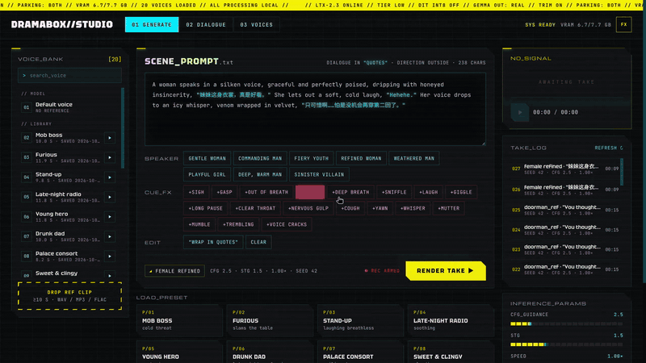

<p align="center">
  
</p>

# DramaBox Studio

[](LICENSE)

A local web studio for **Resemble AI's DramaBox** — expressive, prompt-driven TTS with voice cloning. The prompt controls speaker identity, emotion, delivery, laughs, sighs and pauses; a voice reference clip clones the target timbre.

It runs on NVIDIA GPUs from 8 GB up, and on Apple Silicon.

---

## Demo



Full-quality video: [assets/demo.mp4](assets/demo.mp4)

---

## Features

- **Generate** — write a prompt, pick a reference voice, render. Speaker-tag chips, 18 non-verbal cue chips, a wrap-selection-in-quotes button, and 8 scene presets with full stage directions.
- **Dialogue** — paste a script (`NAME: line`, one per row), parse the cast, assign a voice to each character and an emotion to each line (19 emotions), then render the whole dialogue.
- **Voices** — built-in voices plus your own: upload a reference clip, name it, list and delete it.
- **Take log** — every render is saved to `output/` with a `.json` sidecar of its settings; reuse settings from any take. Waveform player with download.
- **Inference controls** — CFG, STG, speed (0.5–2.0×, pitch unchanged), target length, seed, duration multiplier, reference length used, padding trim and Gemma output mode.
- **VRAM tiers** — picked automatically at startup (see below).
- **Night City UI** — static HTML/CSS/JS in `web/` (no build step) served by FastAPI. The **FX** button turns scanlines and glitch animations off (they are also off when the OS asks for reduced motion). Fonts ship in `web/fonts/`, so it works offline.

---

## Quick Start

### Prerequisites

- Python 3.10 – 3.13
- Linux or Windows with an NVIDIA GPU (**8 GB+ VRAM**) and driver installed; 32 GB RAM recommended for 8–16 GB cards (idle models wait in host RAM)
- or macOS 14+ on Apple Silicon with **16 GB+ unified memory** (see [Apple Silicon](#apple-silicon-mlx))
- ~16 GB free disk space for the model weights
- The install path must contain only ASCII characters

### Install

```bash
git clone https://github.com/Siddid-Soni/DramaBoxStudio.git
cd DramaBoxStudio
pip install torch==2.8.0 torchaudio==2.8.0 --index-url https://download.pytorch.org/whl/cu128
pip install -r requirements.txt
```

Pick the CUDA index matching your driver (`nvidia-smi`, top-right):

| NVIDIA driver | CUDA version | pip index |
|---|---|---|
| >= 572.00 | CUDA 12.8 | `cu128` |
| >= 550.00 | CUDA 12.4 | `cu124` |
| >= 545.00 | CUDA 12.1 | `cu121` |

### Models

Models are **not** downloaded automatically. Place them under `models/`:

| Model | Source | Where to put it |
|---|---|---|
| DiT Transformer (`dramabox-dit-v1.safetensors`) | [ResembleAI/Dramabox](https://huggingface.co/ResembleAI/Dramabox) | `models/checkpoints/` |
| Audio Components (`dramabox-audio-components.safetensors`) | [ResembleAI/Dramabox](https://huggingface.co/ResembleAI/Dramabox) | `models/checkpoints/` |
| Text Encoder (Gemma 3 12B, 4-bit) | [unsloth/gemma-3-12b-it-bnb-4bit](https://huggingface.co/unsloth/gemma-3-12b-it-bnb-4bit) | `models/gemma/` |

If HuggingFace is slow in your region, set `HF_ENDPOINT=https://hf-mirror.com` before downloading with `huggingface-cli download`.

### Launch

```bash
python app.py
```

Open `http://localhost:7860` (it opens by itself). Set `DRAMABOX_NO_BROWSER=1` to stop that, `DRAMABOX_PORT` to change the port.

---

## Apple Silicon (MLX)

Gemma 3 12B 4-bit runs in MLX (`mlx-community/gemma-3-12b-it-4bit`, ~8 GB); the rest of DramaBox runs in PyTorch on MPS.

```bash
pip install -r requirements-mac.txt
huggingface-cli download mlx-community/gemma-3-12b-it-4bit --local-dir models/gemma-mlx
python app.py
```

The DiT and audio components go in `models/checkpoints/` as above; `models/gemma/` (bnb 4-bit) is not needed on a Mac. `DRAMABOX_MLX_GEMMA` points at another MLX Gemma folder.

---

## Speed & Memory Features

Numbers marked *measured* are from an RTX 3070 Ti Laptop (8 GB), 30 steps, a 10 s voice reference and ~9.6 s of audio per line.

- **Runs on 8 GB cards** — a staged low-VRAM pipeline keeps Gemma, the embeddings processor and the audio stage from sitting on the GPU together. *Measured:* 18 s per 9.6 s line, 6.87 GB GPU peak.
- **Prompt embedding cache** — the negative prompt is encoded once and cached on disk. Any prompt seen before (re-rolls, new seeds) is served from the memory/disk cache, so Gemma is skipped entirely and, on 8 / 16 GB, no stage swap happens either.
- **Pinned-RAM parking** — on 8 / 16 GB cards Gemma waits in page-locked host RAM and only swaps onto the GPU for new prompts. *Measured:* ~0.5 s per swap.
- **Padding trim** — Gemma runs on the prompt's real tokens only (`DRAMABOX_TRIM_PADDING`), about 5–10× less Gemma work for typical prompts. *Measured:* 3 new prompts in 1.9 s vs 4.8 s padded, swaps included.
- **Full-precision DiT** — bf16 on 8 / 16 GB cards, with no per-matmul INT8 dequantization.
- **Batched dialogue encoding** — the Dialogue tab encodes every line in one batch first, so Gemma swaps once per script instead of once per line.
- **Voice reference cached** — each voice is VAE-encoded once, not on every generation.
- **Lean embeddings processor** — `project-exact` needs 0.54 GB and `project` 0.08 GB of extra GPU per prompt, instead of 1.44 GB (*measured*).

---

## VRAM Tiers

Picked automatically at startup; override with `DRAMABOX_TIER=low|balanced|performance|mlx-16|mlx-24`.

| Tier | Hardware | How it runs |
|---|---|---|
| `low` | CUDA < 11 GB | Gemma (embedding table looked up on the CPU, ~5.8 GB), the embeddings processor and the audio stage (DiT bf16 + VAE + vocoder, ~7 GB) take turns on the GPU; idle ones wait in pinned host RAM (back in ~0.5 s) |
| `balanced` | CUDA 11–20 GB | Text stage (Gemma + embeddings processor) and audio stage take turns on the GPU |
| `performance` | CUDA ≥ 20 GB | Everything resident on the GPU |
| `mlx-16` | Mac < 24 GB | Gemma in MLX, loaded only to encode new prompts; DiT on MPS |
| `mlx-24` | Mac ≥ 24 GB | Gemma in MLX resident; DiT on MPS |

Prompt embeddings are cached in memory and on disk (`cache/prompt-embeds/`): the negative prompt and any prompt seen before skip Gemma entirely, and the dialogue workshop encodes every line up front so the low-VRAM tiers swap stages once per script. The voice reference is VAE-encoded once per voice.

**Padding trim** (`DRAMABOX_TRIM_PADDING`, default `1`): Gemma runs on the prompt's real tokens only and the hidden states are zero-padded to 1024 afterwards, instead of running all 1024 padded tokens. The padded positions are masked out, so the result should match; set `0` for the original padded path. Apple Silicon always trims.

**Host RAM on `low` / `balanced`** (`DRAMABOX_PARK`): where a stage waits while another uses the GPU.

| `DRAMABOX_PARK` | In host RAM | Swap cost |
|---|---|---|
| `both` (default) | Every stage, all the time (~17 GB on 8 GB cards) | ~0.5 s |
| `ssd` | One big model at a time (~9–10 GB incl. the 2 GB embedding table) | ~0.5 s when the background SSD read finished in time, else the rest of a ~6–7 GB read; ~14 GB of SSD in `cache/park/` |

**Gemma output** (`DRAMABOX_GEMMA_OUTPUT`): on 8 GB cards Gemma's output waits in host RAM while the embeddings processor takes Gemma's place on the GPU; the table is for that tier. On the other tiers Gemma and the processor share the GPU, so nothing is stored (`real` behaves like `full`), and `project` / `project-exact` lower the GPU peak while encoding.

| Value | Stored per prompt | Gemma-stage GPU peak | vs the original padded path (trim off) |
|---|---|---|---|
| `full` | 0.37 GB (trim off) | 6.31 GB | identical |
| `real` (default) | ~0.37 MB per real token | 5.75 GB (trim on) / 6.31 GB (trim off) | identical |
| `project` | ~4 KB per real token | 6.50 GB | ~0.5–1.4% rounding differences |
| `project-exact` | ~4 KB per real token | 7.0 GB (7.47 GB reserved, trim off) | identical; falls back to `project` per prompt if the GPU runs out |

On the other tiers, the extra GPU memory the embeddings processor needs per prompt is 1.44 GB for `full` / `real`, 0.54 GB for `project-exact` (identical output) and 0.08 GB for `project` (~0.5–1.4% rounding differences).

### Environment variables

| Variable | Values | Default |
|---|---|---|
| `DRAMABOX_TIER` | `low`, `balanced`, `performance`, `mlx-16`, `mlx-24` | auto |
| `DRAMABOX_PARK` | `both`, `ssd` | `both` |
| `DRAMABOX_GEMMA_OUTPUT` | `full`, `real`, `project`, `project-exact` | `real` |
| `DRAMABOX_TRIM_PADDING` | `1`, `0` | `1` |
| `DRAMABOX_INT8` | `1` (torchao INT8 DiT, `performance` tier only) | off |
| `DRAMABOX_MLX_GEMMA` | path to an MLX Gemma folder | `models/gemma-mlx` |
| `DRAMABOX_PORT` | port number | `7860` |
| `DRAMABOX_NO_BROWSER` | `1` | off |

```bash
# 8 GB card with 16 GB of RAM: one big model in RAM at a time
DRAMABOX_PARK=ssd python app.py

# headless 8 GB card, exact embeddings with the least RAM
DRAMABOX_TRIM_PADDING=0 DRAMABOX_GEMMA_OUTPUT=project-exact python app.py
```

Padding trim and Gemma output can also be changed live in the UI (**Generate → Advanced**); they apply to the next prompt in both tabs. Tier, parking and INT8 decide how the models are loaded, so they need a restart. On the `low` tier, switching between `full` / `real` and the `project` modes rebuilds the Gemma side on the next new prompt (a few seconds; with `DRAMABOX_PARK=ssd` it needs a restart instead).

---

## Prompt Writing

```
<speaker description>, "<dialogue>" <action direction> "<more dialogue>"
```

**Inside quotes** — spoken aloud:
- Dialogue: `"Hello, how are you?"`
- Vocal sounds (one word): `"Hahaha"` `"Hehehe"` `"Mmmmm"` `"Ugh"`

**Outside quotes** — performed, not spoken:
- `She sighs deeply.` · `A long pause.` · `He clears his throat.`
- `Her voice cracks.` · `He gulps nervously.` · `She drops to a whisper.`

**Never put inside quotes:** `Sigh` `Gasp` `Cough` `Ahem` `Pfft` — the model will speak them literally.

**Tips:**
- Match the speaker description's gender and age to the voice reference
- Break long dialogue with stage directions between segments
- Use the cue chips to insert a non-verbal action at the cursor
- Select text and click **WRAP IN QUOTES** to put it in quotes

---

## Inference Settings

| Parameter | Default | Effect |
|---|---|---|
| CFG | 2.5 | Lower = more natural, higher = more text-faithful |
| STG | 1.5 | Skip-token guidance for expressiveness |
| Speed | 1.0× (0.5–2.0×) | Tempo change without pitch shift |
| Target length | auto | Output length in seconds (0 = estimate from the text) |
| Duration multiplier | 1.1 | Breathing room on the auto-estimated length |
| Reference length used | 10 s | How much of the voice clip is used |
| Seed | — | Fixed seed for repeatable takes |

---

## API

`app.py` exposes a small JSON API (interactive docs at `/api/docs`) for status, options, examples, voices, uploads, generation, dialogue parse/generate, jobs and outputs. Renders go through a single-worker queue (up to 10 waiting), so the GPU runs one job at a time.

---

## License

This project is a derivative of [ResembleAI/DramaBox](https://github.com/resemble-ai/DramaBox), which is an IC-LoRA fine-tune of [Lightricks/LTX-2.3](https://github.com/Lightricks/LTX-2). Distributed under the **LTX-2 Community License Agreement** — see [LICENSE](LICENSE). Please comply with the LTX-2 Acceptable Use Policy when using generated audio.

**Attribution:**
- Original DramaBox by [Resemble AI](https://www.resemble.ai/learn/models/dramabox)
- Base model LTX-2.3 by [Lightricks](https://github.com/Lightricks/LTX-2)
- Community modifications by **Wang Zhifeng**
- VRAM tiers, Apple Silicon (MLX) support, the low-VRAM pipeline and the Night City web frontend by **Siddid Soni**

Model weights are **not** included in this repository.

This is an unofficial community distribution. For the official DramaBox, visit [ResembleAI/DramaBox](https://github.com/resemble-ai/DramaBox).
